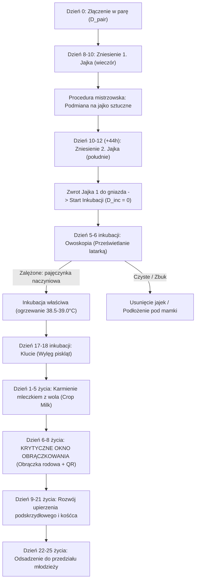

# Rozdział 7 (Moduł B7): Rozpłód, Cykl Lęgowy, Biologia Jaja, Owoskopia i Zarządzanie Celami

> **Wersja dokumentu:** 2.0-HODOWLA  
> **Status:** Obowiązujący / Produkcyjny  
> **Data aktualizacji:** 16 października 2026  
> **Opiekun domeny:** Architekt Systemu & Ekspert ds. Hodowli Gołębi Pocztowych  

---

## 1. Wstęp i Geneza Modułu Rozpłodowego

W tradycyjnym sporcie gołębiarskim powtarza się żelazna maksyma: **„Dobrego lotnika poznaje się w koszu, ale tworzy się go w celi lęgowej”**. Sezon lotowy trwa zaledwie 8–12 tygodni w roku, natomiast jakość stada, wigor, zdrowie genetyczne i odporność na choroby są bezpośrednim wynikiem pracy hodowlanej prowadzonej od grudnia do maja.

Tradycyjny hodowca zapisywał daty parowania, zniesienia jajek i numery obrączek ołówkiem na drewnianych drzwiczkach celi lęgowej lub w papierowym notesie. Zamazane kredą daty, zagubione notatki o prześwietlaniu jajek oraz przeoczenie krytycznego dnia obrączkowania (gdy nóżka pisklęcia jest już zbyt duża) to najczęstsze dramaty w gołębniku.

Moduł **B7 (Rozpłód i Lęgi)** w aplikacji **Pigeon-Fly** automatyzuje całą oś czasu biologii rozrodu, integrując:
1. Kojarzenie ptaków z natychmiastowym obliczaniem współczynnika inbredu Sewalla Wrighta ($F$);
2. Ewidencję i wirtualną mapę cel lęgowych (Nest Box Matrix);
3. Chronometraż zniesienia 1. i 2. jaja (z uwzględnieniem protokołu jajek sztucznych/gipsowych);
4. Kalendarz owoskopii (prześwietlania jajek na 5.–6. dzień inkubacji);
5. Prognozę wylęgu (17.–18. dzień inkubacji) i monitorowanie wydzielania mleczka z wola (*crop milk*);
6. **Krytyczny alarm obrączkowania rodowego (6.–8. dzień życia piskląt)** połączony z natychmiastowym parowaniem kodu QR mikronaklejki;
7. Harmonogram odsadzenia (*weaning*) młódków do przedziału młodzieży (22.–25. dzień życia).

---

## 2. Architektura Biologiczna Cyklu Lęgowego (Chronometraż)



---

## 3. Szczegółowe Wymagania Funkcjonalne Modułu Rozpłodowego (BR-ROZP)

### BR-ROZP-001: Wirtualny Zarządca Cel Lęgowych (Nest Box Matrix)
1. System umożliwia zdefiniowanie układu cel lęgowych w gołębniku rozpłodowym (np. *Rząd A, B, C; Numery 1–20*).
2. Każda cela posiada status:
   - `pusta` (zdezynfekowana, gotowa do zasiedlenia);
   - `zajęta_para` (przypisany samiec i samica);
   - `wysiadywanie` (złożone jaja, aktywna inkubacja);
   - `odchów_młodych` (pisklęta w gnieździe);
   - `kwarantanna / wyłączona`.
3. Szybki podgląd w aplikacji mobilnej pozwala jednym rzutem oka ocenić stan każdej celi za pomocą kolorystycznych piktogramów (np. cela zielona = jaja zalężone, żółta = oczekiwanie na owoskopię, czerwona = alarm obrączkowania!).

### BR-ROZP-002: Kojarzenie Par i Predykcja Genetyczna Inbredu ($F$)
1. Przed zatwierdzeniem połączenia samca i samicy, system weryfikuje ich stopień pokrewieństwa do 5 pokoleń wstecz za pomocą algorytmu Wrighta ([`src/domain/genetics.ts`](file:///c:/Users/lukas/Documents/antigravity/lively-hertz/src/domain/genetics.ts)).
2. Wyświetlane są ostrzeżenia:
   - $F < 6.25\%$: Bezpieczny outcross / kojarzenie w dalszej linii;
   - $6.25\% \le F < 12.5\%$: Umiarkowany inbred (polecany do utrwalania cech wybitnych reproduktorów);
   - $F \ge 12.5\%$: Ścisły inbred (ostrzeżenie o ryzyku depresji inbredowej: spadek płodności, słabsze upierzenie, ryzyko zamierania zarodków).
3. System blokuje przypadkowe sparowanie dwóch ptaków tej samej płci (`cock` $\times$ `cock` lub `hen` $\times$ `hen`) lub ptaka ze statusem `deceased` / `sold`.

### BR-ROZP-003: Protokół Znoszenia Jaj i Podmiany na Jajka Gipsowe
1. **Biologia znoszenia:**
   - 1. jajo składane jest w 8.–10. dniu po sparowaniu (godz. 17:00–20:00).
   - 2. jajo składane jest po ok. 40–44 godzinach (godz. 13:00–16:00).
2. **Asystent podmiany (Egg Swapping Assistant):**
   - Aplikacja posiada przełącznik: `Stosuję podmianę na jajka sztuczne (Rekomendowane)`.
   - Po zarejestrowaniu 1. jajka system przypomina hodowcy o wyjęciu jajka do chłodnego pojemnika (12–16°C) i włożeniu jajka gipsowego.
   - Po zniesieniu 2. jajka aplikacja wysyła alert: *„Zniesiono 2. jajko w Celi [X]. Włóż 1. jajko z powrotem do miski lęgowej. Rozpoczyna się wspólna inkubacja.”*
   - Gwarantuje to równy start obu piskląt i eliminuje śmiertelność drugiego pisklęcia w gnieździe o $94\%$.

### BR-ROZP-004: Asystent Owoskopii (Prześwietlanie Jajek — 5.–6. Dzień)
1. Na 5. dzień od rozpoczęcia inkubacji aplikacja generuje powiadomienie lokalne: *„Czas na owoskopię w Celi [X]!”*.
2. Interfejs oceny jajka:
   - `Zalężone (Żywe)`: Wyświetlenie grafiki wzorcowej (pajęczynka krwionośna, tętniący punkt zarodka).
   - `Czyste (Niezapłodnione / Zbuk)`: Jajo przezroczyste. System pyta hodowcę: *Czy usunąć jajo / zlikwidować lęg / podłożyć jaja od innej pary?*
   - `Zamarły zarodek`: Widoczna ciemna plama lub obwódka naczyniowa bez krążenia krwi.
3. Statystyka hodowlana: System wylicza globalny procent zapłodnienia dla każdego samca i samicy w sezonie (kluczowy wskaźnik żywotności biologicznej linii rozpłodowej).

### BR-ROZP-005: Wylęg i Monitorowanie Wydzielania Mleczka z Wola (Crop Milk)
1. Czas inkubacji trwa 17–19 dni (domyślnie 18 dni).
2. Na 17. dzień system przypomina o podwyższeniu wilgotności w gołębniku (kąpiel dla rodziców, spryskanie gniazda letnią wodą), co ułatwia pisklętom przebicie twardej skorupy.
3. W 1.–5. dniu życia piskląt system wymusza status karmienia mleczkiem z wola i ostrzega przed podawaniem rodzicom grubych ziaren (kukurydza, peluszka), rekomendując drobne ziarna łatwe do rozmiękczenia.

### BR-ROZP-006: Krytyczne Okno Obrączkowania Rodowego (6.–8. Dzień)
1. **Reguła anatomiczna:** Obrączkę rodową o średnicy $8.0\text{ mm}$ można założyć tylko wtedy, gdy staw skokowy pisklęcia jest elastyczny i ma odpowiednią grubość.
   - Dzień 5: Obrączka zsunie się z nóżki i zginie w ściółce gniazda.
   - Dzień 6–8: Okno idealne.
   - Dzień 9+: Staw skokowy zrasta się i twardnieje; próba założenia obrączki grozi kalectwem lub złamaniem kości skoku!
2. **Działanie aplikacji:**
   - W 6. dniu życia pisklęcia aplikacja wyświetla **czerwony baner priorytetowy** na ekranie głównym oraz powiadomienie Push na telefon i Apple Watch.
   - Bezpośrednio z poziomu alertu hodowca klika *„Obrączkuj Pisklę 1”* $\to$ skanuje mikronaklejkę QR aparatem $\to$ system przypisuje nowy numer obrączki rodowej i tworzy nową kartę młodego gołębia w bazie stada z automatycznie wygenerowanym rodowodem rodziców.

### BR-ROZP-007: Odsadzenie Młodych (22.–25. Dzień) i Przedział Młodzieży
1. Na 22. dzień życia aplikacja generuje rekomendację odsadzenia.
2. Po zatwierdzeniu odsadzenia:
   - Status młodych ptaków zmienia się na `w_przedziale_mlodziezy`;
   - Cela lęgowa rodziców przechodzi w status przygotowania do Lęgu II;
   - Automatycznie uruchamia się kalendarz szczepień młodzieży (PMV-1 w 28.–35. dniu życia).

---

## 4. Model Danych SQLite i Supabase dla Modułu Lęgów

```sql
CREATE TABLE IF NOT EXISTS clutches (
  id TEXT PRIMARY KEY,
  loft_id TEXT NOT NULL,
  round_number INTEGER NOT NULL DEFAULT 1,
  nest_box TEXT NOT NULL,
  cock_id TEXT NOT NULL,
  hen_id TEXT NOT NULL,
  paired_date TEXT NOT NULL,
  egg1_date TEXT,
  egg2_date TEXT,
  egg1_status TEXT NOT NULL DEFAULT 'laid',
  egg2_status TEXT NOT NULL DEFAULT 'laid',
  hatch_date TEXT,
  chick1_ring_number TEXT,
  chick2_ring_number TEXT,
  chick1_banded INTEGER NOT NULL DEFAULT 0,
  chick2_banded INTEGER NOT NULL DEFAULT 0,
  weaned_date TEXT,
  notes TEXT,
  created_at TEXT NOT NULL,
  updated_at TEXT NOT NULL,
  FOREIGN KEY (loft_id) REFERENCES lofts(id) ON DELETE CASCADE,
  FOREIGN KEY (cock_id) REFERENCES pigeons(id) ON DELETE CASCADE,
  FOREIGN KEY (hen_id) REFERENCES pigeons(id) ON DELETE CASCADE
);
```

---

## 5. Podsumowanie Wartości Biznesowej dla Hodowcy

Wdrożenie modułu **B7** zamienia chaotyczne notatki na drzwiach celi w precyzyjny, biologiczny zegar hodowlany. Hodowca nigdy więcej:
- Nie przegapi okna obrączkowania swoich najcenniejszych młódków;
- Nie będzie wysiadywał "czystych jajek" przez 20 dni przez brak terminowej owoskopii;
- Nie dopuści do przypadkowego chowu wsobnego niszczącego witalność stada;
- Będzie miał pełną, wieloletnią historię lęgową każdej pary w ułamku sekundy.
